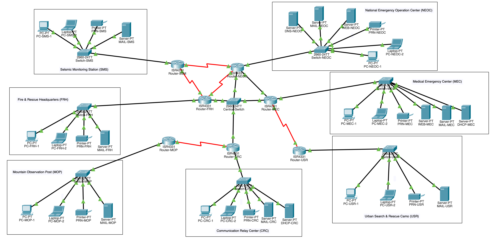
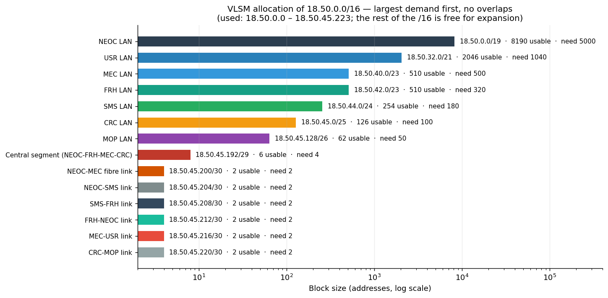
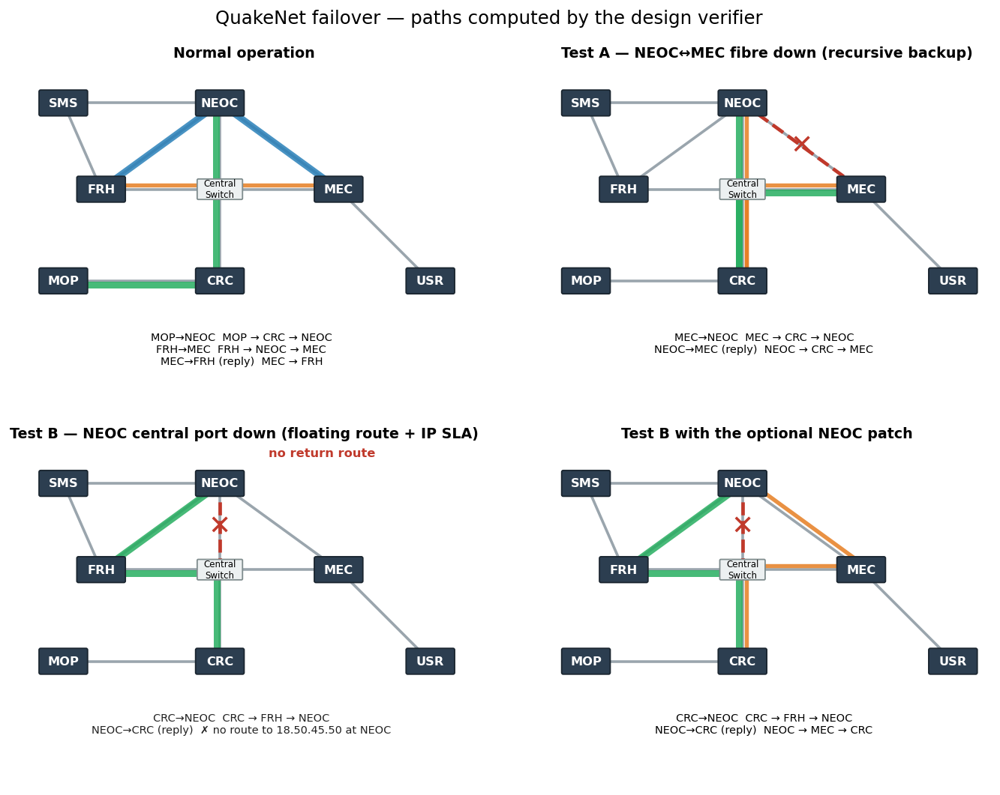

# QuakeNet — Earthquake Early Warning & Emergency Response Network

[](https://github.com/tanvirul-islam-rifat/quakenet-emergency-network/actions/workflows/ci.yml)


A national **disaster-response network** for seven operational units, designed and configured in Cisco Packet Tracer: one `/16` carved with **VLSM** into 14 subnets (from a `/19` with 5,000 hosts down to `/30` links), a hybrid routing design — a **RIPv2** warning loop plus recursive, exit-interface and **floating static routes** with **IP SLA object tracking** — **no default route anywhere**, three DHCP models (router, dedicated servers, relay), central DNS, two web servers and seven mail domains with cross-domain delivery.

The design is also **verified as code**. A Python tool parses the router configurations, rebuilds every routing table (including tracked routes), forwards 112 flows hop by hop in normal operation and under both failure tests, and cross-checks addressing and DHCP — backed by 31 unit tests. It reproduces the route counts of all seven real Packet Tracer `show ip route` captures, and it found a missing route in the printed configs and a real gap in the central-port failover (see [Verifier Findings](#verifier-findings)).



## At a Glance

| | |
|---|---|
| **Units** | NEOC (core) · SMS · FRH · MEC · USR · CRC · MOP — 1 router + 1 switch + 2 PCs + 1 printer + 1 mail server each |
| **Address plan** | `18.50.0.0/16` → 14 VLSM subnets (`/19` … `/30`), `18.50.0.0 – 18.50.45.223` used, the rest reserved for growth |
| **Routing** | RIPv2 on NEOC/SMS/FRH · recursive statics (MEC, CRC, MOP) · exit-interface statics (USR) · `redistribute static` · **no default route** |
| **Failover** | Recursive backup (MEC) and IP SLA-tracked floating static (CRC), both AD 48, with return-path routes on NEOC |
| **Services** | DHCP on the NEOC router (3 pools), on dedicated MEC/CRC servers (2 pools each) and via 4 relay agents · DNS · 2 web servers · 7 mail servers |
| **Deliverables** | `.pkt` file · configs · addressing tables · 23-page report · automated design verifier |

## Addressing — VLSM

Requirements were sorted largest-first and allocated sequentially. The base network `18.50.0.0/16` comes from the last four digits (1850) of the student ID assigned by the project specification; the administrative distance for backup routes (**48**) is the digit sum of a second assigned ID (12) multiplied by the group size (4).

| Network | Hosts needed | Subnet | Usable |
|---|---|---|---|
| NEOC LAN | 5000 | 18.50.0.0/19 | 8190 |
| USR LAN | 1040 | 18.50.32.0/21 | 2046 |
| MEC LAN | 500 | 18.50.40.0/23 | 510 |
| FRH LAN | 320 | 18.50.42.0/23 | 510 |
| SMS LAN | 180 | 18.50.44.0/24 | 254 |
| CRC LAN | 100 | 18.50.45.0/25 | 126 |
| MOP LAN | 50 | 18.50.45.128/26 | 62 |
| Central segment (NEOC · FRH · MEC · CRC) | 4 | 18.50.45.192/29 | 6 |
| NEOC↔MEC fibre · NEOC↔SMS · SMS↔FRH · FRH↔NEOC · MEC↔USR · CRC↔MOP | 2 each | 18.50.45.200 … .220 /30 | 2 each |

Two sizing decisions matter: 5,000 hosts overflow a `/20` (4,094 usable), so the NEOC LAN gets a `/19`; and 1,040 hosts overflow a `/22` (1,022 usable), so USR gets a `/21`.



Full tables (router interfaces, servers, printers, switches, cabling): [`addressing/`](addressing/).

## Routing Design

| Router | Method |
|---|---|
| **Router-NEOC** | RIPv2 on the warning loop (serial links) · six next-hop statics to MEC/USR/CRC/MOP · `redistribute static` into RIP · floating return-path routes |
| **Router-SMS**, **Router-FRH** | RIPv2 only — they learn the whole static half through NEOC's redistribution |
| **Router-MEC** | Recursive next-hop statics · recursive **backup** via CRC (AD 48) for the NEOC/SMS networks |
| **Router-CRC** | Recursive statics · **floating static** via FRH (AD 48) with the primary bound to an **IP SLA** track object |
| **Router-USR** | 12 exit-interface (directly attached) statics — valid on a point-to-point serial uplink |
| **Router-MOP** | 12 next-hop statics towards CRC — a stub that may not use a default route |

Design decisions worth knowing:

- **Passive interfaces keep RIP contained.** `network 18.0.0.0` would enable RIP everywhere, so LAN, central-segment and fibre interfaces are passive; they are still *advertised* but send no updates towards the static-only routers.
- **No default route.** Every router carries explicit network routes — which is why MOP and USR need twelve each.
- **Fibre link as Gigabit.** The ISR4331 has no fibre port without extra modules; the substitution changes no routing behaviour.
- **Central segment as a `/29`.** The smallest block holding four router interfaces plus the switch management address.

## Failover: Recursive Backup vs. Floating Static + IP SLA

The two backup mechanisms fail for different reasons, which is the interesting part:

- **MEC (recursive backup).** The primary next hop `18.50.45.201` lives on the fibre's own `/30`. When the fibre goes down, that connected route disappears, the recursive lookup fails, the primary is withdrawn and the AD-48 route via CRC installs by itself.
- **CRC (floating static).** The primary next hop (`.193`, NEOC) and the floating one (`.194`, FRH) are on the *same* connected `/29`, so both always resolve while CRC's interface is up — the primary would never be withdrawn. An **IP SLA ICMP probe** to NEOC with `track 1` is bound to the primary routes; when the probe fails the track goes down and the floating route takes over.



| State | Flow | Computed path |
|---|---|---|
| Normal | MOP → NEOC | MOP → CRC → NEOC |
| Normal | FRH → MEC · MEC → FRH (reply) | FRH → NEOC → MEC · MEC → FRH over the central segment |
| **Test A** — NEOC↔MEC fibre down | MEC → NEOC · NEOC → MEC (return) | MEC → CRC → NEOC · NEOC → CRC → MEC |
| **Test B** — NEOC central port down | CRC → NEOC | CRC → FRH → NEOC |

Both tests were also executed in Packet Tracer (shutdown on the NEOC interface, `show ip route` / `show track 1`, `tracert`, restore) — see the report, section 15.

## Services

| Service | Implementation |
|---|---|
| **DHCP — router** | NEOC serves its own LAN, SMS and FRH from three pools, with excluded ranges protecting static addresses |
| **DHCP — servers** | DHCP-MEC (MEC + USR pools) and DHCP-CRC (CRC + MOP pools); default `serverPool` disabled so it cannot answer instead |
| **DHCP — relay** | `ip helper-address` on SMS and FRH (→ NEOC router), USR (→ DHCP-MEC) and MOP (→ DHCP-CRC) |
| **DNS** | One central server, 18.50.0.2 — 12 A records, including the bare `neoc.gov` / `mec.gov` records that cross-domain mail relay depends on |
| **Web** | `www.neoc.alert.gov` and `www.mec.alert.gov`, opened by name from a PC in every unit |
| **Email** | Seven `<unit>.gov` domains; NEOC ↔ MEC cross-domain delivery verified in both directions for two user pairs |

## Automated Design Verification

Packet Tracer files cannot be diffed or tested, so the repository treats the design as code:

```
$ python -m tools.validate_design        # excerpt, long check names abbreviated
[PASS] VLSM plan equals a fresh largest-first allocation of the requirements          14 subnets
[PASS] No duplicate IP addresses across routers, servers, printers and switches       all unique
[PASS] Every ip helper-address reaches a DHCP source that serves the relayed LAN      4 relay agents
[PASS] Every backup (floating) static route uses administrative distance 48           ok
[PASS] No default route (0.0.0.0/0) exists on any router                              ok
[PASS] Full reachability, scenario normal                                             112 flows delivered
[PASS] Full reachability, scenario A: NEOC-MEC fibre down                             112 flows delivered
[WARN] Full reachability, scenario B: NEOC central-switch port down                   12 of 112 flows fail ...
[PASS] test B: CRC -> NEOC reroutes through FRH (track 1 down)                        CRC -> FRH -> NEOC
[PASS] IP SLA track 1 is Up normally and in Test A, Down in Test B                    normal=True, A=True, B=False
[PASS] Justification: without IP SLA tracking, CRC keeps its dead primary route       next hop 18.50.45.193 unreachable
[PASS] Justification: CRC needs its static route to the MOP LAN                       12 of 112 flows fail without it
[PASS] Optional NEOC patch, scenario B: full reachability                             112 flows delivered

39 passed, 1 finding(s), 0 failed          (excerpt — 40 checks in total)
```

What it does:

1. **Parses** the seven router configs (interfaces, helper addresses, static/floating/tracked routes, RIP, DHCP pools, IP SLA and track objects).
2. **Builds each routing table** — connected, statics with next-hop resolution, floating routes by administrative distance, track state, RIPv2 with passive interfaces and static redistribution — and **forwards traffic hop by hop** (longest-prefix match, loop detection).
3. **Replays both failover tests** and checks 112 flows per state: every LAN pair plus every LAN to DNS, both web servers and all seven mail servers.
4. **Cross-checks** the VLSM table, device tables, gateways, DHCP exclusions, relay targets and server pools against the configs.

**Calibrated against Packet Tracer:** the number of routes the model builds on each router equals the `N subnets` count in the real `show ip route` capture for all seven routers (19, 18, 17, 18, 17, 16, 16) — a regression test keeps it that way.

The 31 tests in [`tests/`](tests/) also prove the verifier *catches mistakes*: duplicate IPs, addresses outside the plan, a wrong floating distance, an unresolvable next hop, a stray default route, a deleted route, a missing DHCP exclusion, a wrong helper target, a tracked route without a probe, and a forwarding loop.

## Verifier Findings

1. **A route was missing from the printed configs.** Router-CRC needs `ip route 18.50.45.128 255.255.255.192 18.50.45.222` (MOP LAN). The Packet Tracer capture shows it, the original report listing did not; without it the MOP LAN is unreachable. Restored in [`configs/routers/Router-CRC.txt`](configs/routers/Router-CRC.txt).
2. **Test B restores the forward path but not the return path (model prediction).** With NEOC's central port down, CRC and MOP reach NEOC through FRH. But NEOC's statics to the CRC/MOP LANs use next hop `18.50.45.196` on that same segment, so they cannot resolve and nothing replaces them: NEOC — and, through redistribution, SMS and FRH — has no route back (12 of 112 flows). An optional three-line patch, [`configs/patches/NEOC_testB_return_path.txt`](configs/patches/NEOC_testB_return_path.txt), adds floating routes on NEOC via the NEOC–MEC fibre (MEC already routes to CRC); in the model it restores all 112 flows in Test B and changes nothing in normal operation or Test A. It is **not** applied in `QuakeNet.pkt`, and it has not been run in Packet Tracer.
3. **FRH ↔ MEC is asymmetric.** FRH reaches the MEC LAN through NEOC (RIP), while MEC replies directly over the central segment.

## Run It

**Open the network:** open [`packet-tracer/QuakeNet.pkt`](packet-tracer/QuakeNet.pkt) in Cisco Packet Tracer. To rebuild a device by hand, paste the matching file from [`configs/`](configs/) into its CLI.

**Verify the design** (Python 3.10+, standard library only):

```bash
git clone https://github.com/tanvirul-islam-rifat/quakenet-emergency-network.git
cd quakenet-emergency-network

python -m tools.validate_design                      # addressing, configs, DHCP, routing, failover
python -m unittest discover -s tests -t . -v         # 31 tests
python -m tools.vlsm                                 # print the VLSM allocation
```

Optional: `pip install -r requirements.txt && python -m tools.make_figures` regenerates the figures; `python -m tools.build_report` rebuilds the PDF report from [`docs/PROJECT_REPORT.md`](docs/PROJECT_REPORT.md) (needs pandoc and wkhtmltopdf).

## Repository Structure

```
├── README.md
├── packet-tracer/QuakeNet.pkt                # the network
├── configs/
│   ├── routers/                              # 7 router configurations (CLI-pasteable)
│   ├── switches/                             # 8 switch configurations
│   └── patches/                              # optional NEOC patch for Test B (not applied in the .pkt)
├── addressing/                               # VLSM requirements/plan, interfaces, devices, cabling (CSV)
├── services/                                 # DHCP servers, DNS records, mail accounts, web pages
├── tools/
│   ├── vlsm.py                               # VLSM allocator
│   ├── design_model.py                       # config parser + RIB / IP SLA / forwarding simulator
│   ├── validate_design.py                    # design verifier (CLI)
│   ├── make_figures.py                       # figures from verified data
│   └── build_report.py                       # report PDF builder
├── tests/                                    # 31 unit tests incl. negative tests and Packet Tracer calibration
├── docs/
│   ├── QuakeNet_Project_Report.pdf           # 23-page project report
│   ├── PROJECT_REPORT.md                     # report source
│   └── images/                               # topology, figures, Packet Tracer screenshots
└── .github/workflows/ci.yml
```

## Limitations

- **Single core router.** NEOC hosts DNS, a web server, a mail server and DHCP for three units; its failure disables name resolution system-wide. A second core router with HSRP would fix this.
- **MOP and USR have one uplink** and therefore no backup path.
- **Test B return path** is incomplete in the submitted design (Finding 2); the optional patch is not applied.
- **Static routing does not scale** — every new subnet needs a manual route on MEC, CRC, USR and MOP; OSPF would remove the manual redistribution too.
- **RIPv2** has a 15-hop limit and slow convergence.
- **No MX records** — Packet Tracer does not implement them, so mail routing relies on A records.
- **No security layer** (VLAN segmentation, ACLs, port security, SSH) — outside the project scope.
- The verifier is a purpose-built model of the features this design uses (connected, static, floating, tracked, RIPv2); it models the IP SLA probe as reachability of a target on the source interface's segment, and is not a general IOS emulator. RIP metrics may differ by one from Packet Tracer's display, which does not affect forwarding. Console/enable passwords (`cisco` / `class`) and mail passwords are lab-only values.

## Technical Architecture
- **Platform:** Cisco Packet Tracer — 7 × ISR4331 routers (NIM-2T serial modules), 8 × 2960-24TT switches, PCs, laptops, printers and servers
- **Protocols:** IPv4 with VLSM, RIPv2 with redistribution, recursive / exit-interface / floating-static routing, IP SLA with object tracking, DHCP with relay, DNS, HTTP, SMTP / POP3
- **Verification tooling:** Python 3 standard library (`ipaddress`, `csv`, `unittest`); matplotlib for figures
- **Data Storage:** Plain-text router/switch configurations and CSV addressing tables under version control
- **Interface:** Cisco IOS CLI, Packet Tracer GUI, and a Python command-line verifier

## Core Engineering Practices Demonstrated
- **Efficient Address Planning:** Largest-first VLSM across a 50-to-5,000-host range, aligned and non-overlapping, with the rest of the `/16` kept free for growth.
- **Hybrid Routing Under Constraints:** RIP and three static styles in one network with no default route, joined by redistribution and passive-interface hygiene.
- **Understanding *Why* Failover Works:** Recursive backup versus tracked floating static — the design uses IP SLA exactly where the primary route cannot withdraw itself, and each choice is proven necessary by a reproducible negative test.
- **Network as Code:** Configurations, addressing and services as versioned text; a config parser plus a routing/forwarding simulator verify reachability before anything is deployed.
- **Evidence-Based Verification:** The model is calibrated against real Packet Tracer output and surfaced a missing route and an incomplete failover path that a manual review of the printed configs missed.
- **Testing Discipline:** 31 unit tests including intentionally broken designs, and CI that runs them on every push.
- **Traceable Documentation:** The report's configuration listings are generated from `configs/`, so documentation cannot drift from the implementation.
- **Honest Engineering:** Findings, limitations and an unapplied patch are documented as such rather than hidden.

## Author
**Md. Tanvirul Islam Rifat** — designed, configured, tested and documented this network.
- **GitHub:** [@tanvirul-islam-rifat](https://github.com/tanvirul-islam-rifat)
- **LinkedIn:** [Tanvirul Islam Rifat](https://www.linkedin.com/in/tanvirul-islam-rifat)
