| | |
|---|---|
| **Author** | Md. Tanvirul Islam Rifat |
| **Institution** | BRAC University — Computer Science and Engineering |
| **Project type** | Networking course project (Cisco Packet Tracer), Summer 2026 |
| **Base network** | 18.50.0.0/16 (derived from the last four digits, 1850, of the student ID assigned by the project specification) |
| **Administrative distance** | 48 (derived from the digit sum of an assigned student ID × group size) |
| **Contents of this repository** | Packet Tracer file, router/switch configurations, addressing tables, services, automated design verifier |

# 1. Introduction and Objectives

QuakeNet is a simulated national Earthquake Early Warning and Emergency Response Network built in Cisco Packet Tracer for a Ministry of Disaster Management. The network connects seven operational units: the National Emergency Operation Center (NEOC), the Seismic Monitoring Station (SMS), the Fire and Rescue Headquarters (FRH), the Medical Emergency Center (MEC), the Urban Search and Rescue Camp (USR), the Communication Relay Center (CRC) and the Mountain Observation Post (MOP).

Each unit is represented by a dedicated router, a dedicated LAN switch, two PCs that represent all the users of that unit, and one network printer. Every unit also hosts its own email server. The NEOC is the core of the network: it hosts the central DNS server, one of the two web servers, and serves DHCP for three units. The MEC is a second service centre, hosting the other web server and its own DHCP server.

The design deliberately mixes routing styles. The three units on the warning loop run RIPv2, while the remaining four are reached exclusively through static routes in three styles: recursive next-hop routes, exit-interface routes and floating backup routes. **No default route is permitted anywhere in the system**, so every destination must be reachable through a specific network route.

The main objectives are:

- Derive a base network from a student ID and subnet it efficiently with VLSM for seven LANs of widely differing sizes (50 to 5000 hosts).
- Design a topology that satisfies every connectivity constraint of the specification, including a shared central-switch segment, a point-to-point fibre link and a three-router warning loop.
- Combine RIPv2 with several styles of static routing, and redistribute static routes into RIPv2 so both halves of the network learn each other.
- Configure centralised DHCP on a router, distributed DHCP on dedicated servers, and DHCP relay with `ip helper-address` for remote units.
- Configure a central DNS service, two web servers and seven email servers, and demonstrate cross-domain email between two independent mail domains.
- Implement a recursive backup route and a floating static route (with IP SLA tracking) so a backup path is used automatically when a primary link fails, and verify this with two independent link-failure tests.

# 2. Assumptions

Each assumption is technically sound, does not conflict with any requirement, and does not remove or simplify any compulsory feature.

1. **Users.** Two PCs and one printer represent all the users of each unit. Every VLSM block is still sized for the full stated host count (5000, 1040, 500, 320, 180, 100 and 50).
2. **Hardware.** Cisco ISR4331 routers for all seven units; Cisco 2960-24TT switches for all eight switches (seven unit switches and one central switch).
3. **Serial modules.** A NIM-2T module is installed in every router to provide the serial WAN interfaces of the warning loop and the two stub links.
4. **Clocking.** All serial links run at 64000 bps, clock rate set on the DCE end; interface bandwidth is left at its default.
5. **Static addressing.** Servers, printers and switch management interfaces (VLAN 1) use static IP addresses. Only the unit PCs use DHCP.
6. **Fibre link.** The NEOC–MEC fibre link is implemented as a GigabitEthernet point-to-point connection, because the ISR4331 has no fibre-capable port without extra modules. No routing requirement changes.
7. **Central segment.** The four routers on the central switch share one broadcast domain, addressed as a /29 — the smallest block for four router interfaces plus the switch management address.
8. **USR router.** It uses directly attached (exit-interface only) static routes, valid because its single uplink is a point-to-point serial link.
9. **Return-path backups on NEOC.** Floating routes with administrative distance 48 are also configured on NEOC towards the MEC and USR LANs. Without them the traffic would fail in the return direction during a fibre failure.
10. **Backup distance.** Administrative distance 48 is used for every backup route.
11. **IP SLA tracking.** IP SLA with object tracking is configured on CRC so the floating static route can genuinely be demonstrated: both of CRC's candidate next hops lie on the same connected /29, so without tracking the primary route would never be withdrawn.
12. **No default route** (0.0.0.0/0) exists anywhere, as required.
13. **Credentials.** `cisco123` for all email accounts; `cisco` / `class` for console and privileged EXEC access — lab-only values, chosen for simplicity.
14. **Mail domains.** Each unit uses `<unit>.gov`. Only NEOC and MEC need two mailboxes; the other five units have one demonstration mailbox each.

# 3. Base Network and Administrative Distance

## 3.1 Base network address

The base network is derived from the student ID that the project specification designates; only its last four digits are needed:

| Step | Operation | Result |
|---|---|---|
| 1 | Take the last four digits of the designated student ID | 1850 |
| 2 | Split into two groups of two digits | 18 and 50 |
| 3 | First pair becomes the first octet | 18 |
| 4 | Second pair becomes the second octet | 50 |
| 5 | Third and fourth octets are zero, prefix is /16 | **18.50.0.0/16** |

The base network is **18.50.0.0/16** (default mask 255.255.0.0). This /16 provides 65,534 usable host addresses, far more than the 7,190 users of the seven units; the surplus is deliberately left unallocated for future units.

## 3.2 Administrative distance

The administrative distance for every backup route is derived from a second assigned student ID, multiplied by the group size:

| Step | Operation | Result |
|---|---|---|
| 1 | Sum of the digits of the assigned student ID | 12 |
| 2 | Number of members in the group | 4 |
| 3 | Administrative distance = digit sum × group size | 12 × 4 = **48** |

An administrative distance of 48 is higher than the default of 1 for a static route, so a backup route with AD 48 stays out of the routing table while the primary static route is valid and installs automatically the moment the primary is withdrawn. (It is also lower than RIP's 120, which matters for floating routes that compete with RIP-learned prefixes.)

# 4. VLSM Design and Subnetting Table

VLSM sorts all required networks from the largest host requirement to the smallest and allocates aligned blocks sequentially from the start of 18.50.0.0/16, which prevents fragmentation and guarantees no overlap. The allocation is reproduced by `tools/vlsm.py` and checked against the table below by the automated verifier.

## 4.1 Host requirement analysis

| Network | Required hosts | Block size | Prefix | Usable hosts |
|---|---|---|---|---|
| NEOC LAN | 5000 | 8192 | /19 | 8190 |
| USR LAN | 1040 | 2048 | /21 | 2046 |
| MEC LAN | 500 | 512 | /23 | 510 |
| FRH LAN | 320 | 512 | /23 | 510 |
| SMS LAN | 180 | 256 | /24 | 254 |
| CRC LAN | 100 | 128 | /25 | 126 |
| MOP LAN | 50 | 64 | /26 | 62 |
| Central segment (NEOC, FRH, MEC, CRC) | 4 | 8 | /29 | 6 |
| NEOC ↔ MEC fibre link | 2 | 4 | /30 | 2 |
| NEOC ↔ SMS link | 2 | 4 | /30 | 2 |
| SMS ↔ FRH link | 2 | 4 | /30 | 2 |
| FRH ↔ NEOC link | 2 | 4 | /30 | 2 |
| MEC ↔ USR link | 2 | 4 | /30 | 2 |
| CRC ↔ MOP link | 2 | 4 | /30 | 2 |

The NEOC LAN needs 5000 hosts. A /20 provides only 4094 usable addresses, so a /19 (8190) was allocated. Likewise the USR LAN needs 1040 hosts, so a /21 (2046) was allocated rather than a /22, which provides only 1022.

## 4.2 Complete subnetting table

| # | Network | Subnet | Mask | Usable range | Broadcast |
|---|---|---|---|---|---|
| 1 | NEOC LAN | 18.50.0.0/19 | 255.255.224.0 | 18.50.0.1 – 18.50.31.254 | 18.50.31.255 |
| 2 | USR LAN | 18.50.32.0/21 | 255.255.248.0 | 18.50.32.1 – 18.50.39.254 | 18.50.39.255 |
| 3 | MEC LAN | 18.50.40.0/23 | 255.255.254.0 | 18.50.40.1 – 18.50.41.254 | 18.50.41.255 |
| 4 | FRH LAN | 18.50.42.0/23 | 255.255.254.0 | 18.50.42.1 – 18.50.43.254 | 18.50.43.255 |
| 5 | SMS LAN | 18.50.44.0/24 | 255.255.255.0 | 18.50.44.1 – 18.50.44.254 | 18.50.44.255 |
| 6 | CRC LAN | 18.50.45.0/25 | 255.255.255.128 | 18.50.45.1 – 18.50.45.126 | 18.50.45.127 |
| 7 | MOP LAN | 18.50.45.128/26 | 255.255.255.192 | 18.50.45.129 – 18.50.45.190 | 18.50.45.191 |
| 8 | Central segment | 18.50.45.192/29 | 255.255.255.248 | 18.50.45.193 – 18.50.45.198 | 18.50.45.199 |
| 9 | NEOC ↔ MEC | 18.50.45.200/30 | 255.255.255.252 | 18.50.45.201 – 18.50.45.202 | 18.50.45.203 |
| 10 | NEOC ↔ SMS | 18.50.45.204/30 | 255.255.255.252 | 18.50.45.205 – 18.50.45.206 | 18.50.45.207 |
| 11 | SMS ↔ FRH | 18.50.45.208/30 | 255.255.255.252 | 18.50.45.209 – 18.50.45.210 | 18.50.45.211 |
| 12 | FRH ↔ NEOC | 18.50.45.212/30 | 255.255.255.252 | 18.50.45.213 – 18.50.45.214 | 18.50.45.215 |
| 13 | MEC ↔ USR | 18.50.45.216/30 | 255.255.255.252 | 18.50.45.217 – 18.50.45.218 | 18.50.45.219 |
| 14 | CRC ↔ MOP | 18.50.45.220/30 | 255.255.255.252 | 18.50.45.221 – 18.50.45.222 | 18.50.45.223 |

The address space from 18.50.45.224 to 18.50.255.255 remains unallocated and is reserved for future expansion.


# 5. Network Topology

The topology satisfies every structural constraint of the specification:

- Each of the seven operational units is represented by a separate router.
- MOP is connected only to CRC, through a serial link on 18.50.45.220/30.
- NEOC, FRH, MEC and CRC are connected through one central switch on the 18.50.45.192/29 segment.
- A direct point-to-point fibre link joins NEOC and MEC on 18.50.45.200/30, in addition to their shared central-switch connection.
- The warning loop is formed by three links: NEOC ↔ SMS, SMS ↔ FRH and FRH ↔ NEOC.
- USR is connected only to MEC, through a serial link on 18.50.45.216/30.
- Each unit has its own LAN switch, two PCs and one printer.
- Each unit hosts its own email server; only NEOC and MEC host web servers; only NEOC hosts the central DNS server.


## 5.1 Physical connections

| # | From | Interface | To | Interface | Link type |
|---|---|---|---|---|---|
| 1 | Router-NEOC | G0/0/0 | Switch-NEOC | Fa0/1 | Copper straight-through |
| 2 | Router-NEOC | G0/0/1 | Central-Switch | Fa0/1 | Copper straight-through |
| 3 | Router-FRH | G0/0/1 | Central-Switch | Fa0/2 | Copper straight-through |
| 4 | Router-MEC | G0/0/1 | Central-Switch | Fa0/3 | Copper straight-through |
| 5 | Router-CRC | G0/0/1 | Central-Switch | Fa0/4 | Copper straight-through |
| 6 | Router-NEOC | G0/0/2 | Router-MEC | G0/0/2 | Point-to-point fibre link |
| 7 | Router-NEOC (DCE) | S0/1/0 | Router-SMS | S0/1/0 | Serial, 64000 bps |
| 8 | Router-SMS (DCE) | S0/1/1 | Router-FRH | S0/1/0 | Serial, 64000 bps |
| 9 | Router-NEOC (DCE) | S0/1/1 | Router-FRH | S0/1/1 | Serial, 64000 bps |
| 10 | Router-MEC (DCE) | S0/1/0 | Router-USR | S0/1/0 | Serial, 64000 bps |
| 11 | Router-CRC (DCE) | S0/1/0 | Router-MOP | S0/1/0 | Serial, 64000 bps |
| 12 | Each unit router | G0/0/0 | Its unit switch | Fa0/1 | Copper straight-through |
| 13 | PCs, printers, servers | Fa0 | Unit switch | Fa0/2 onward | Copper straight-through |

# 6. Device IP Addressing

## 6.1 Router interfaces

| Router | Interface | IP address | Subnet mask | Connects to |
|---|---|---|---|---|
| Router-NEOC | G0/0/0 | 18.50.0.1 | 255.255.224.0 | Switch-NEOC |
| | G0/0/1 | 18.50.45.193 | 255.255.255.248 | Central-Switch |
| | G0/0/2 | 18.50.45.201 | 255.255.255.252 | Router-MEC (fibre) |
| | S0/1/0 (DCE) | 18.50.45.205 | 255.255.255.252 | Router-SMS |
| | S0/1/1 (DCE) | 18.50.45.214 | 255.255.255.252 | Router-FRH |
| Router-SMS | G0/0/0 | 18.50.44.1 | 255.255.255.0 | Switch-SMS |
| | S0/1/0 (DTE) | 18.50.45.206 | 255.255.255.252 | Router-NEOC |
| | S0/1/1 (DCE) | 18.50.45.209 | 255.255.255.252 | Router-FRH |
| Router-FRH | G0/0/0 | 18.50.42.1 | 255.255.254.0 | Switch-FRH |
| | G0/0/1 | 18.50.45.194 | 255.255.255.248 | Central-Switch |
| | S0/1/0 (DTE) | 18.50.45.210 | 255.255.255.252 | Router-SMS |
| | S0/1/1 (DTE) | 18.50.45.213 | 255.255.255.252 | Router-NEOC |
| Router-MEC | G0/0/0 | 18.50.40.1 | 255.255.254.0 | Switch-MEC |
| | G0/0/1 | 18.50.45.195 | 255.255.255.248 | Central-Switch |
| | G0/0/2 | 18.50.45.202 | 255.255.255.252 | Router-NEOC (fibre) |
| | S0/1/0 (DCE) | 18.50.45.217 | 255.255.255.252 | Router-USR |
| Router-CRC | G0/0/0 | 18.50.45.1 | 255.255.255.128 | Switch-CRC |
| | G0/0/1 | 18.50.45.196 | 255.255.255.248 | Central-Switch |
| | S0/1/0 (DCE) | 18.50.45.221 | 255.255.255.252 | Router-MOP |
| Router-USR | G0/0/0 | 18.50.32.1 | 255.255.248.0 | Switch-USR |
| | S0/1/0 (DTE) | 18.50.45.218 | 255.255.255.252 | Router-MEC |
| Router-MOP | G0/0/0 | 18.50.45.129 | 255.255.255.192 | Switch-MOP |
| | S0/1/0 (DTE) | 18.50.45.222 | 255.255.255.252 | Router-CRC |

## 6.2 Servers, printers and switches

| Device | Role | IP address | Subnet mask | Default gateway | DNS |
|---|---|---|---|---|---|
| DNS-NEOC | Central DNS | 18.50.0.2 | 255.255.224.0 | 18.50.0.1 | 18.50.0.2 |
| WEB-NEOC | www.neoc.alert.gov | 18.50.0.3 | 255.255.224.0 | 18.50.0.1 | 18.50.0.2 |
| MAIL-NEOC | neoc.gov | 18.50.0.4 | 255.255.224.0 | 18.50.0.1 | 18.50.0.2 |
| PRN-NEOC | Printer | 18.50.0.5 | 255.255.224.0 | 18.50.0.1 | 18.50.0.2 |
| Switch-NEOC | Management | 18.50.0.6 | 255.255.224.0 | 18.50.0.1 | — |
| MAIL-USR | usr.gov | 18.50.32.2 | 255.255.248.0 | 18.50.32.1 | 18.50.0.2 |
| PRN-USR | Printer | 18.50.32.3 | 255.255.248.0 | 18.50.32.1 | 18.50.0.2 |
| Switch-USR | Management | 18.50.32.4 | 255.255.248.0 | 18.50.32.1 | — |
| WEB-MEC | www.mec.alert.gov | 18.50.40.2 | 255.255.254.0 | 18.50.40.1 | 18.50.0.2 |
| MAIL-MEC | mec.gov | 18.50.40.3 | 255.255.254.0 | 18.50.40.1 | 18.50.0.2 |
| DHCP-MEC | DHCP server | 18.50.40.4 | 255.255.254.0 | 18.50.40.1 | 18.50.0.2 |
| PRN-MEC | Printer | 18.50.40.5 | 255.255.254.0 | 18.50.40.1 | 18.50.0.2 |
| Switch-MEC | Management | 18.50.40.6 | 255.255.254.0 | 18.50.40.1 | — |
| MAIL-FRH | frh.gov | 18.50.42.2 | 255.255.254.0 | 18.50.42.1 | 18.50.0.2 |
| PRN-FRH | Printer | 18.50.42.3 | 255.255.254.0 | 18.50.42.1 | 18.50.0.2 |
| Switch-FRH | Management | 18.50.42.4 | 255.255.254.0 | 18.50.42.1 | — |
| MAIL-SMS | sms.gov | 18.50.44.2 | 255.255.255.0 | 18.50.44.1 | 18.50.0.2 |
| PRN-SMS | Printer | 18.50.44.3 | 255.255.255.0 | 18.50.44.1 | 18.50.0.2 |
| Switch-SMS | Management | 18.50.44.4 | 255.255.255.0 | 18.50.44.1 | — |
| MAIL-CRC | crc.gov | 18.50.45.2 | 255.255.255.128 | 18.50.45.1 | 18.50.0.2 |
| DHCP-CRC | DHCP server | 18.50.45.3 | 255.255.255.128 | 18.50.45.1 | 18.50.0.2 |
| PRN-CRC | Printer | 18.50.45.4 | 255.255.255.128 | 18.50.45.1 | 18.50.0.2 |
| Switch-CRC | Management | 18.50.45.5 | 255.255.255.128 | 18.50.45.1 | — |
| MAIL-MOP | mop.gov | 18.50.45.130 | 255.255.255.192 | 18.50.45.129 | 18.50.0.2 |
| PRN-MOP | Printer | 18.50.45.131 | 255.255.255.192 | 18.50.45.129 | 18.50.0.2 |
| Switch-MOP | Management | 18.50.45.132 | 255.255.255.192 | 18.50.45.129 | — |
| Central-Switch | Management | 18.50.45.197 | 255.255.255.248 | 18.50.45.193 | — |

All fourteen PCs (two per unit) obtain their addressing dynamically through DHCP. Every switch management address falls inside a DHCP excluded range (or outside every dynamic pool) so it can never conflict with a dynamically assigned address.

# 7. DHCP Configuration

DHCP is provided in three ways, as the specification requires: centrally from the NEOC router, from dedicated servers in MEC and CRC, and through DHCP relay for the units with no local DHCP service.

## 7.1 Centralised DHCP on the NEOC router

The NEOC router serves three pools — its own LAN, SMS and FRH. The first nine addresses of each subnet are excluded so the router interface, servers, printer and switch management address stay reserved.

```
ip dhcp excluded-address 18.50.0.1 18.50.0.9
ip dhcp excluded-address 18.50.44.1 18.50.44.9
ip dhcp excluded-address 18.50.42.1 18.50.42.9
ip dhcp pool NEOC-POOL
 network 18.50.0.0 255.255.224.0
 default-router 18.50.0.1
 dns-server 18.50.0.2
 domain-name neoc.gov
ip dhcp pool SMS-POOL
 network 18.50.44.0 255.255.255.0
 default-router 18.50.44.1
 dns-server 18.50.0.2
 domain-name sms.gov
ip dhcp pool FRH-POOL
 network 18.50.42.0 255.255.254.0
 default-router 18.50.42.1
 dns-server 18.50.0.2
 domain-name frh.gov
```

## 7.2 DHCP relay on the remote routers

A DHCP discover is a broadcast and a router does not forward it. Four units therefore carry an `ip helper-address` statement on their LAN interface, converting the broadcast into a unicast towards the correct DHCP service.

| Router | LAN interface | ip helper-address | Points to |
|---|---|---|---|
| Router-SMS | G0/0/0 | 18.50.0.1 | NEOC router DHCP service |
| Router-FRH | G0/0/0 | 18.50.0.1 | NEOC router DHCP service |
| Router-USR | G0/0/0 | 18.50.40.4 | DHCP-MEC server |
| Router-MOP | G0/0/0 | 18.50.45.3 | DHCP-CRC server |

## 7.3 Dedicated DHCP servers in MEC and CRC

The MEC and CRC units each run a DHCP server (Server-PT). Each holds two pools: one for its own LAN and one for the relayed remote LAN. The default `serverPool` on both servers was disabled so it cannot answer a request in place of the configured pools.

| Server | Pool name | Default gateway | DNS server | Start IP | Subnet mask | Max users |
|---|---|---|---|---|---|---|
| DHCP-MEC (18.50.40.4) | MEC-POOL | 18.50.40.1 | 18.50.0.2 | 18.50.40.10 | 255.255.254.0 | 500 |
| DHCP-MEC (18.50.40.4) | USR-POOL | 18.50.32.1 | 18.50.0.2 | 18.50.32.10 | 255.255.248.0 | 1040 |
| DHCP-CRC (18.50.45.3) | CRC-POOL | 18.50.45.1 | 18.50.0.2 | 18.50.45.10 | 255.255.255.128 | 110 |
| DHCP-CRC (18.50.45.3) | MOP-POOL | 18.50.45.129 | 18.50.0.2 | 18.50.45.140 | 255.255.255.192 | 50 |

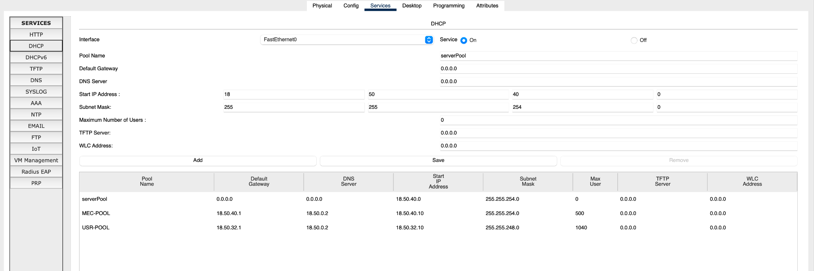

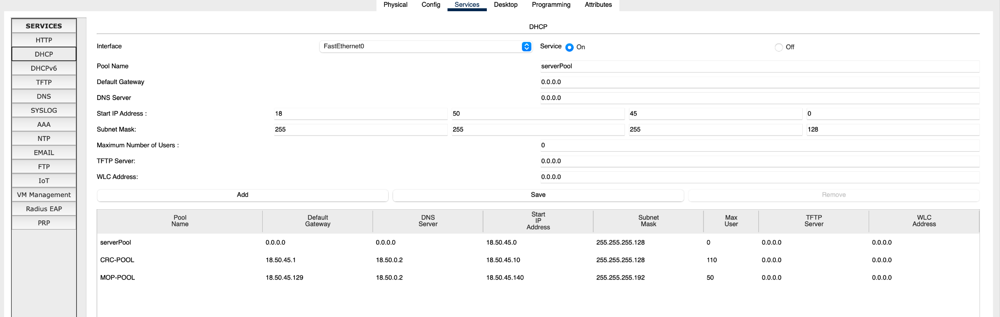

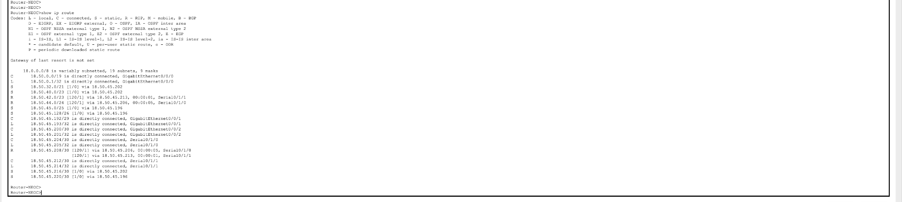

# 8. DNS Configuration

The central DNS server, DNS-NEOC at 18.50.0.2, is the only DNS server in the network and is used by every unit. All servers, printers and DHCP pools point to it.

| # | Name | Type | Address |
|---|---|---|---|
| 1 | www.neoc.alert.gov | A | 18.50.0.3 |
| 2 | www.mec.alert.gov | A | 18.50.40.2 |
| 3 | mail.neoc.gov | A | 18.50.0.4 |
| 4 | mail.mec.gov | A | 18.50.40.3 |
| 5 | mail.sms.gov | A | 18.50.44.2 |
| 6 | mail.frh.gov | A | 18.50.42.2 |
| 7 | mail.usr.gov | A | 18.50.32.2 |
| 8 | mail.crc.gov | A | 18.50.45.2 |
| 9 | mail.mop.gov | A | 18.50.45.130 |
| 10 | neoc.gov | A | 18.50.0.4 |
| 11 | mec.gov | A | 18.50.40.3 |
| 12 | dns.neoc.gov | A | 18.50.0.2 |

Records 10 and 11 are essential. When a mail server relays a message to another domain it resolves the bare domain name, not the `mail.` host name, so without an A record for `neoc.gov` and `mec.gov` the cross-domain delivery would fail even though every other record is correct.

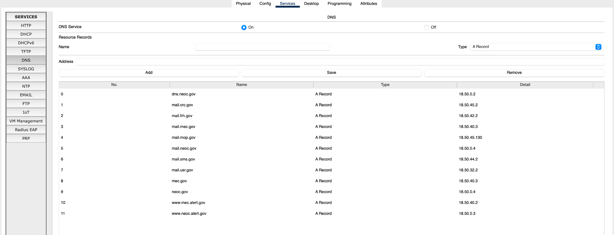

# 9. Web Servers

Only NEOC and MEC host web servers. Both run HTTP and serve a distinct index page so browser screenshots show which server answered.

| Server | IP address | Domain name | Service |
|---|---|---|---|
| WEB-NEOC | 18.50.0.3 | www.neoc.alert.gov | HTTP enabled |
| WEB-MEC | 18.50.40.2 | www.mec.alert.gov | HTTP enabled |

Both sites were opened by domain name, not IP address, from a PC in every one of the seven units, which simultaneously proves end-to-end routing, DNS resolution and web server operation.

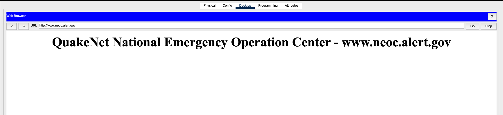

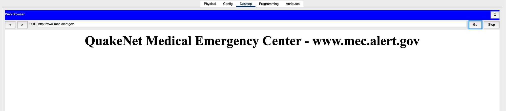

# 10. Email Servers

Every unit hosts its own email server with the domain `<unit>.gov`. NEOC and MEC carry two accounts each because cross-domain email between those two units with at least two users each is required.

| Mail server | IP address | Domain | User accounts | Password |
|---|---|---|---|---|
| MAIL-NEOC | 18.50.0.4 | neoc.gov | neoc.admin, neoc.ops | cisco123 |
| MAIL-MEC | 18.50.40.3 | mec.gov | mec.doctor, mec.nurse | cisco123 |
| MAIL-SMS | 18.50.44.2 | sms.gov | sms.user1 | cisco123 |
| MAIL-FRH | 18.50.42.2 | frh.gov | frh.user1 | cisco123 |
| MAIL-USR | 18.50.32.2 | usr.gov | usr.user1 | cisco123 |
| MAIL-CRC | 18.50.45.2 | crc.gov | crc.user1 | cisco123 |
| MAIL-MOP | 18.50.45.130 | mop.gov | mop.user1 | cisco123 |

SMTP and POP3 were enabled on all seven servers.

## 10.1 Mail client configuration on the PCs

| PC | Display name | Email address | Incoming / outgoing server |
|---|---|---|---|
| PC-NEOC-1 | NEOC Admin | neoc.admin@neoc.gov | mail.neoc.gov |
| PC-NEOC-2 | NEOC Ops | neoc.ops@neoc.gov | mail.neoc.gov |
| PC-MEC-1 | MEC Doctor | mec.doctor@mec.gov | mail.mec.gov |
| PC-MEC-2 | MEC Nurse | mec.nurse@mec.gov | mail.mec.gov |

## 10.2 Cross-domain mail delivery

Cross-domain delivery was verified in both directions. A message from neoc.admin@neoc.gov to mec.doctor@mec.gov leaves the NEOC mail server, which resolves `mec.gov` through DNS-NEOC, obtains 18.50.40.3 and relays the message over the fibre link. The reply travels the same path in reverse. The test was repeated for the second user pair, neoc.ops and mec.nurse.

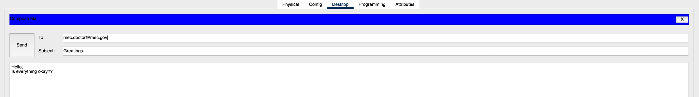

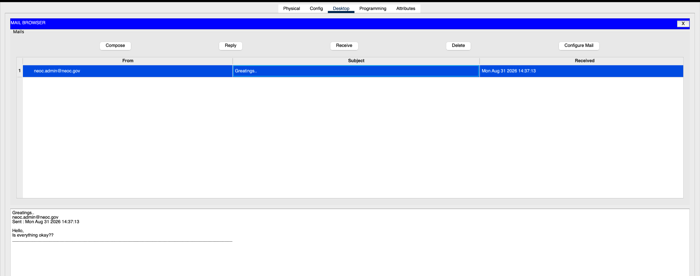

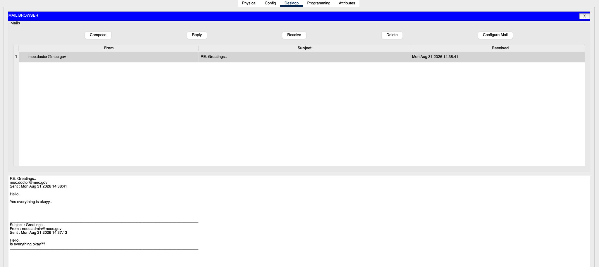

# 11. Routing Configuration

The routing design divides the network into a dynamically routed half and a statically routed half, joined by route redistribution on the NEOC router. No default route exists anywhere.

| Router | Routing method | Notes |
|---|---|---|
| Router-NEOC | RIPv2 + static + redistribution | RIPv2 on the warning loop; redistributes its static routes with metric 5 |
| Router-SMS | RIPv2 only | Two serial interfaces active in RIP, LAN interface passive |
| Router-FRH | RIPv2 only | Two serial interfaces active in RIP, LAN and central-switch interfaces passive |
| Router-MEC | Static only | Recursive next-hop routes with a recursive backup through CRC |
| Router-CRC | Static only | Recursive next-hop routes with a floating static route through FRH, tracked with IP SLA |
| Router-USR | Static only | Exit-interface (directly attached) routes only |
| Router-MOP | Static only | Recursive next-hop routes towards CRC |

## 11.1 Dynamic routing — RIPv2

RIPv2 runs on NEOC, SMS and FRH, which form the warning loop. Version 2 is classless and carries subnet masks, which is mandatory for a VLSM design; automatic summarisation is disabled for the same reason.

```
router rip
 version 2
 no auto-summary
 network 18.0.0.0
 passive-interface GigabitEthernet0/0/0
 passive-interface GigabitEthernet0/0/1
 passive-interface GigabitEthernet0/0/2
 redistribute static metric 5
```

`network 18.0.0.0` activates RIP on every interface in the block, so the LAN, central-segment and fibre interfaces are made passive. A passive interface is still advertised in updates but sends none. This keeps RIP traffic away from MEC and CRC (which run static routing only) while their segments stay reachable from the RIP domain. `redistribute static` injects NEOC's static routes into RIPv2, so SMS and FRH learn the MEC, USR, CRC and MOP networks without any static configuration of their own.

## 11.2 Static routes and redistribution on the NEOC router

```
ip route 18.50.40.0   255.255.254.0   18.50.45.202    ! MEC LAN via fibre
ip route 18.50.32.0   255.255.248.0   18.50.45.202    ! USR LAN via MEC
ip route 18.50.45.216 255.255.255.252 18.50.45.202    ! MEC-USR link
ip route 18.50.45.0   255.255.255.128 18.50.45.196    ! CRC LAN
ip route 18.50.45.128 255.255.255.192 18.50.45.196    ! MOP LAN
ip route 18.50.45.220 255.255.255.252 18.50.45.196    ! CRC-MOP link
```

## 11.3 Recursive static routes on the MEC router

MEC uses recursive (next-hop) static routes only: the route names the next-hop IP but no exit interface, so the router performs a second lookup to find how to reach that next hop.

```
ip route 18.50.0.0    255.255.224.0   18.50.45.201    ! NEOC LAN over the fibre
ip route 18.50.44.0   255.255.255.0   18.50.45.201    ! SMS LAN
ip route 18.50.42.0   255.255.254.0   18.50.45.194    ! FRH LAN via central switch
ip route 18.50.45.0   255.255.255.128 18.50.45.196    ! CRC LAN
ip route 18.50.45.128 255.255.255.192 18.50.45.196    ! MOP LAN
ip route 18.50.32.0   255.255.248.0   18.50.45.218    ! USR LAN
```

## 11.4 Static routes on the CRC router

CRC reaches the NEOC and SMS networks through the central switch (NEOC), the FRH networks through the FRH router, the MEC and USR networks through the MEC router, and the MOP LAN through the MOP end of the CRC–MOP link (18.50.45.222). It also carries the floating static route described in Section 12.2.

The route to the MOP LAN (`ip route 18.50.45.128 255.255.255.192 18.50.45.222`) is present in the Packet Tracer routing-table capture (Router-CRC, `S 18.50.45.128/26 [1/0] via 18.50.45.222`) but was missing from the configuration listing printed in the original report. It is restored in `configs/routers/Router-CRC.txt`; the automated verifier shows that without it the MOP LAN is unreachable.

## 11.5 Exit-interface static routes on the USR router

USR uses directly attached static routes, which name only the exit interface. This is valid because the USR uplink is a point-to-point serial link on which no next-hop resolution is needed. Twelve routes cover every remote network — seven LAN/segment networks and five WAN /30 networks (the sixth, MEC–USR, is directly connected); no default route is used.

```
ip route 18.50.0.0    255.255.224.0   Serial0/1/0
ip route 18.50.40.0   255.255.254.0   Serial0/1/0
ip route 18.50.42.0   255.255.254.0   Serial0/1/0
ip route 18.50.44.0   255.255.255.0   Serial0/1/0
ip route 18.50.45.0   255.255.255.128 Serial0/1/0
ip route 18.50.45.128 255.255.255.192 Serial0/1/0
ip route 18.50.45.192 255.255.255.248 Serial0/1/0
ip route 18.50.45.200 255.255.255.252 Serial0/1/0
ip route 18.50.45.204 255.255.255.252 Serial0/1/0
ip route 18.50.45.208 255.255.255.252 Serial0/1/0
ip route 18.50.45.212 255.255.255.252 Serial0/1/0
ip route 18.50.45.220 255.255.255.252 Serial0/1/0
```

## 11.6 Static routes on the MOP router

MOP is a pure stub with a single serial uplink to CRC. Because the specification forbids a default route, twelve explicit next-hop static routes towards 18.50.45.221 are configured instead (see `configs/routers/Router-MOP.txt`).

# 12. Recursive and Floating Backup Routes

Two independent backup mechanisms are implemented, both using administrative distance 48. A route with AD 48 is less preferred than the corresponding primary static route (AD 1), so it stays out of the routing table until the primary route is withdrawn.

## 12.1 Recursive backup route on the MEC router

MEC reaches the NEOC networks over the point-to-point fibre link as its primary path. A second set of recursive routes points at CRC with administrative distance 48. When the fibre interface goes down, the 18.50.45.200/30 connected route disappears, the recursive lookup for next hop 18.50.45.201 fails, the primary route is removed, and the AD 48 route through CRC installs automatically.

```
! primary (AD 1)
ip route 18.50.0.0    255.255.224.0   18.50.45.201
ip route 18.50.44.0   255.255.255.0   18.50.45.201
ip route 18.50.45.204 255.255.255.252 18.50.45.201
! recursive backup via CRC (AD 48)
ip route 18.50.0.0    255.255.224.0   18.50.45.196 48
ip route 18.50.44.0   255.255.255.0   18.50.45.196 48
ip route 18.50.45.204 255.255.255.252 18.50.45.196 48
```

## 12.2 Floating static route on the CRC router

CRC maintains a floating static route towards NEOC through FRH. The primary next hop (18.50.45.193) and the floating next hop (18.50.45.194) sit on the same directly connected /29 segment, so a recursive lookup for either always succeeds while CRC's own interface is up. The primary route would therefore never be withdrawn and the floating route could never install on its own.

To make the floating route operational, IP SLA with object tracking is used. An ICMP echo probe monitors the NEOC next hop and the primary routes are bound to that track object. When NEOC stops responding, the track goes down, the primary route is withdrawn, and the AD 48 route through FRH installs.

```
ip sla 1
 icmp-echo 18.50.45.193 source-interface GigabitEthernet0/0/1
 frequency 5
ip sla schedule 1 life forever start-time now
track 1 ip sla 1 reachability
!
ip route 18.50.0.0  255.255.224.0 18.50.45.193 track 1    ! primary, AD 1
ip route 18.50.44.0 255.255.255.0  18.50.45.193 track 1
!
ip route 18.50.0.0  255.255.224.0 18.50.45.194 48         ! floating via FRH
ip route 18.50.44.0 255.255.255.0  18.50.45.194 48
```

## 12.3 Return-path backup routes on the NEOC router

A backup path is only usable if it exists in both directions. If only MEC had a backup route, traffic would reach NEOC during a fibre failure but the replies would be dropped. NEOC therefore carries matching AD 48 routes towards the MEC and USR networks through CRC.

```
ip route 18.50.40.0   255.255.254.0   18.50.45.196 48
ip route 18.50.32.0   255.255.248.0   18.50.45.196 48
ip route 18.50.45.216 255.255.255.252 18.50.45.196 48
```

Because NEOC redistributes its static routes into RIPv2, these backup routes are propagated to SMS and FRH automatically when they become active.

# 13. Device Configurations

The complete configurations are included in the repository as text files that can be pasted into each device's CLI (`configs/routers/` and `configs/switches/`). The listings below are generated from those files.

{{include configs/routers/Router-NEOC.txt}}

{{include configs/routers/Router-SMS.txt}}

{{include configs/routers/Router-FRH.txt}}

{{include configs/routers/Router-MEC.txt}}

{{include configs/routers/Router-CRC.txt}}

{{include configs/routers/Router-USR.txt}}

{{include configs/routers/Router-MOP.txt}}

## 13.1 Switch configuration

All eight switches are configured identically apart from hostname, management address and default gateway. Switch-NEOC is shown in full; the others use the values below.

| Switch | VLAN 1 IP address | Subnet mask | Default gateway |
|---|---|---|---|
| Switch-SMS | 18.50.44.4 | 255.255.255.0 | 18.50.44.1 |
| Switch-FRH | 18.50.42.4 | 255.255.254.0 | 18.50.42.1 |
| Switch-MEC | 18.50.40.6 | 255.255.254.0 | 18.50.40.1 |
| Switch-USR | 18.50.32.4 | 255.255.248.0 | 18.50.32.1 |
| Switch-CRC | 18.50.45.5 | 255.255.255.128 | 18.50.45.1 |
| Switch-MOP | 18.50.45.132 | 255.255.255.192 | 18.50.45.129 |
| Central-Switch | 18.50.45.197 | 255.255.255.248 | 18.50.45.193 |

{{include configs/switches/Switch-NEOC.txt}}

# 14. Testing and Results

The network was verified in four stages: interface and routing verification, end-to-end connectivity, service verification and failover testing.

## 14.1 Interface and routing verification

```
show ip interface brief   ! all configured interfaces up / up
show ip route             ! executed on every router
show ip protocols         ! RIPv2, no auto-summary (NEOC, SMS, FRH)
show ip route rip         ! executed on SMS and FRH
show ip dhcp binding      ! executed on Router-NEOC
show cdp neighbors
```

On every router the output confirms that no gateway of last resort is set, satisfying the requirement that no default route exists anywhere in the system.

**Router-NEOC**

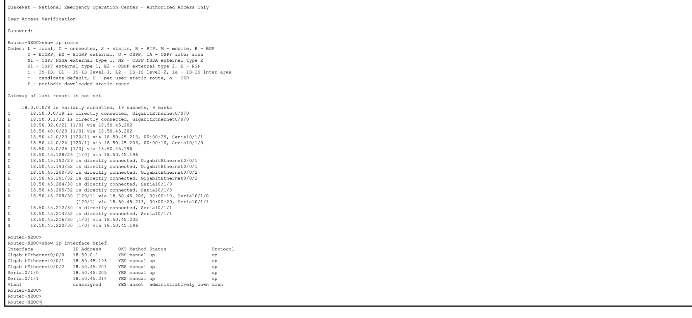

**Router-SMS**

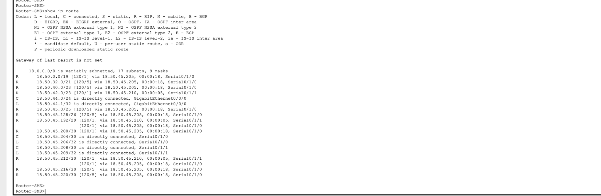

**Router-FRH**

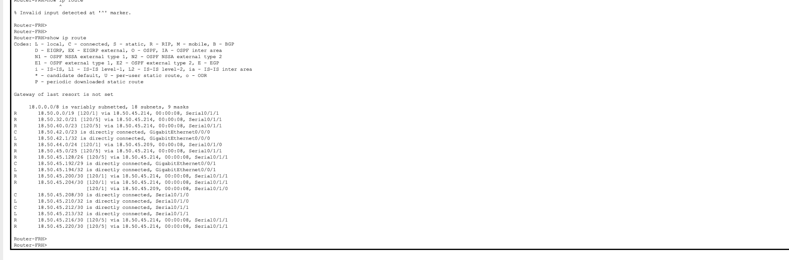

**Router-MEC**

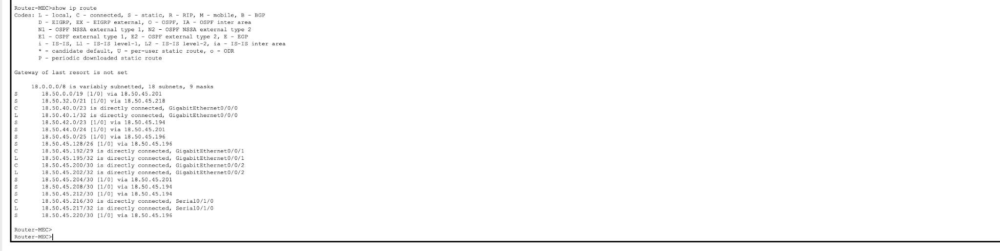

**Router-CRC**

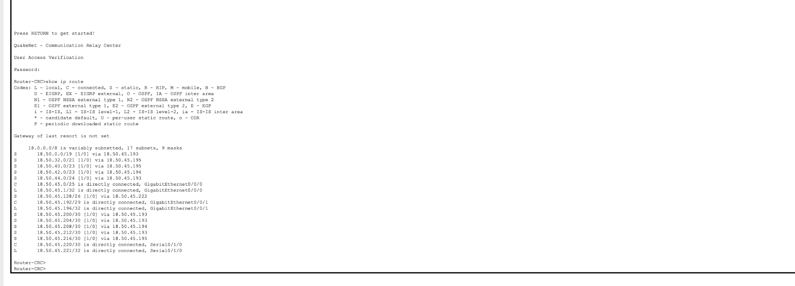

**Router-USR**

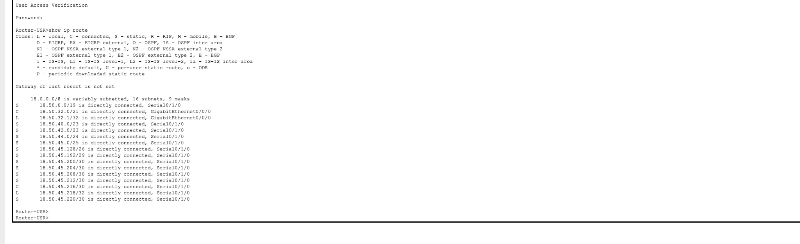

**Router-MOP**

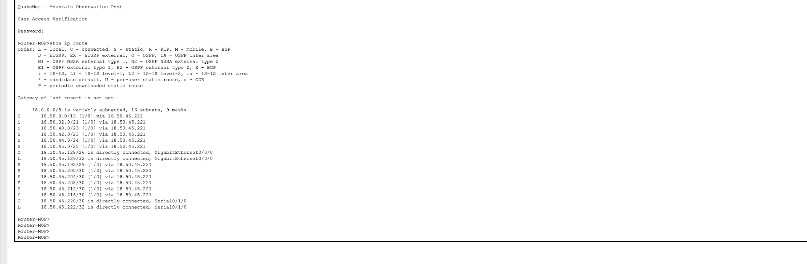

## 14.2 Connectivity tests

| # | Test | Source | Destination | Purpose | Result |
|---|---|---|---|---|---|
| 1 | ping | PC-MOP-1 | 18.50.0.3 | MOP reaches the NEOC web server through CRC and the central switch | Success |
| 2 | ping | PC-USR-1 | PC-SMS-1 | Exit-interface static routes plus redistribution | Success |
| 3 | ping | PC-SMS-1 | 18.50.45.130 | RIP half of the network reaches the static half | Success |
| 4 | ping | PC-CRC-1 | PC-USR-1 | CRC reaches USR through MEC | Success |
| 5 | ping | PC-FRH-1 | 18.50.40.2 | FRH reaches the MEC web server | Success |
| 6 | tracert | PC-FRH-1 | 18.50.40.2 | FRH → NEOC → MEC forward; MEC's reply uses the central segment (route to the FRH LAN via 18.50.45.194) | Success (asymmetric path) |
| 7 | tracert | PC-MOP-1 | 18.50.0.3 | Path must be MOP → CRC → NEOC | Path via CRC |
| 8 | ipconfig /all | One PC per unit | — | Confirms dynamic addressing and relay | Lease received |
| 9 | browser | One PC per unit | both websites | Confirms DNS and HTTP from all seven units | Both sites open |
| 10 | email | PC-NEOC-1 | PC-MEC-1 | Cross-domain delivery in both directions | Delivered |

# 15. Failover Testing

The two backup mechanisms were tested separately. In each test the primary link was administratively shut down, the routing table was re-examined, the new path was verified with a traceroute, and the link was then restored.

## 15.1 Test A — recursive backup route, failure of the NEOC ↔ MEC fibre link

1. On Router-MEC run `show ip route 18.50.0.0` and record the primary route via 18.50.45.201 with administrative distance 1.
2. Record the normal path with `tracert 18.50.0.3` from PC-MEC-1; the traffic crosses the fibre link.
3. On Router-NEOC enter interface configuration mode for GigabitEthernet0/0/2 and issue `shutdown`.
4. Wait about ten seconds and run `show ip route 18.50.0.0` on Router-MEC again.
5. The route via 18.50.45.201 is removed and the recursive backup via 18.50.45.196 (AD 48) is installed.
6. Run `ping 18.50.0.3` and `tracert 18.50.0.3` from PC-MEC-1; the traffic now travels through the CRC router.
7. Issue `no shutdown` on GigabitEthernet0/0/2; the original path is restored.

## 15.2 Test B — floating static route, failure of the NEOC central-switch port

1. On Router-CRC run `show ip route 18.50.0.0` and `show track 1`; record the primary route via 18.50.45.193 and track state Up.
2. Record the normal path with `tracert 18.50.0.3` from PC-CRC-1.
3. On Router-NEOC enter interface configuration mode for GigabitEthernet0/0/1 and issue `shutdown`.
4. Wait about ten seconds and run `show track 1` on Router-CRC; the reachability state is now Down.
5. Run `show ip route 18.50.0.0` on Router-CRC; the floating static route via 18.50.45.194 (AD 48) is now installed.
6. Run `tracert 18.50.0.3` from PC-CRC-1; the forward traffic now travels through the FRH router.
7. Issue `no shutdown` on GigabitEthernet0/0/1; the original path is restored.

The two tests were run separately; both links were never shut down at the same time.

## 15.3 Independent verification with the design verifier

In addition to the Packet Tracer tests, the repository contains a Python verifier (`python -m tools.validate_design`) that parses the router configurations, rebuilds each router's routing table (connected, static, floating, tracked, RIPv2 with `redistribute static`) and forwards traffic hop by hop in normal operation and under both failure scenarios. It models the IP SLA probe as reachability of the target on the CRC's central-segment interface. In every state it checks 112 flows: every LAN pair plus every LAN to DNS, both web servers and all seven mail servers. As a calibration, the number of routes the model builds on each of the seven routers equals the `N subnets` count printed in the corresponding Packet Tracer `show ip route` capture (19, 18, 17, 18, 17, 16 and 16 for NEOC, FRH, SMS, MEC, CRC, USR and MOP).

| State | Flow | Computed path |
|---|---|---|
| Normal | MOP → NEOC | MOP → CRC → NEOC |
| Normal | FRH → MEC | FRH → NEOC → MEC |
| Normal | MEC → FRH (reply) | MEC → FRH (central segment) |
| Test A (fibre down) | MEC → NEOC | MEC → CRC → NEOC |
| Test A | NEOC → MEC (return) | NEOC → CRC → MEC |
| Test A | USR → NEOC | USR → MEC → CRC → NEOC |
| Test B (NEOC central port down) | CRC → NEOC | CRC → FRH → NEOC |
| Test B | MOP → NEOC | MOP → CRC → FRH → NEOC |


Normal operation and Test A deliver all 112 flows. The verifier also confirms the design justifications: without NEOC's return-path floating routes Test A breaks the reverse direction; without IP SLA tracking CRC keeps its dead primary route in Test B; and without CRC's route to the MOP LAN, MOP is unreachable.

## 15.4 Findings

**Finding 1 — CRC route to the MOP LAN.** The printed CRC listing lacked `ip route 18.50.45.128 255.255.255.192 18.50.45.222`, although the Packet Tracer capture shows it. The route is restored in the repository configuration.

**Finding 2 — return traffic in Test B.** The forward failover works (CRC and MOP reach NEOC through FRH once track 1 goes down), but NEOC's own static routes to the CRC and MOP LANs use next hop 18.50.45.196 on the central segment. While NEOC's central port is shut those routes cannot resolve and nothing replaces them, so NEOC (and, through redistribution, SMS and FRH) has no route back to the CRC and MOP LANs: 12 of 112 flows fail in the model, all towards those LANs. The three-line optional patch `configs/patches/NEOC_testB_return_path.txt` adds floating routes on NEOC via the fibre link to MEC (which already routes to CRC); in the model it restores all 112 flows in Test B and leaves NEOC's routing table unchanged in normal operation and in Test A. It is *not* applied in the Packet Tracer file, and the finding comes from the verifier's model, not from a Packet Tracer run.

**Finding 3 — asymmetric path FRH ↔ MEC.** FRH reaches the MEC LAN through NEOC (RIP route from NEOC's redistributed static), while MEC reaches the FRH LAN directly over the central segment. Connectivity test 6 was therefore reworded to describe the forward and reply paths separately.

# 16. Conclusion and Limitations

QuakeNet implements a complete national earthquake early-warning and emergency-response infrastructure for seven operational units within a single /16 block. VLSM kept the addressing efficient, consuming only 18.50.0.0 through 18.50.45.223 and leaving the remainder free for future units.

Dynamic and static routing coexist in one network: RIPv2 handles the three routers of the warning loop, while the four remaining units are reached through static routes in different styles (recursive next-hop and directly attached). Redistribution lets the dynamically routed part learn the statically routed part without manual configuration on SMS and FRH.

The backup routes were the most instructive part. The recursive backup on MEC fails over on its own, because the fibre is a physically separate interface: losing it removes the connected network on which the primary next hop depends. The floating route on CRC behaves differently — both candidate next hops lie on the same connected segment, so the primary never becomes invalid by itself and IP SLA object tracking was needed to make the failover observable. A floating static route is only as reliable as the mechanism that withdraws the route it backs up. Backups were also needed in both directions, which is why NEOC carries return-path routes; Finding 2 shows the same principle applies to the central-port failure.

Limitations of the design:

- **Single core router.** NEOC hosts the central DNS, a web server, a mail server and DHCP for three units; its failure disables name resolution for the whole system. A second core router with HSRP would address this.
- **MOP and USR have a single uplink**, so neither has any backup path.
- **Test B return path.** NEOC has no route back to the CRC and MOP LANs while its central-switch port is down (Finding 2); an optional patch is provided but not applied.
- **RIPv2** has a 15-hop limit and slow convergence; OSPF would scale better and remove the manual redistribution.
- **Static routing** on MEC, CRC, USR and MOP does not scale: every new subnet needs a manual route statement on four routers.
- **No MX records.** Packet Tracer does not implement them, so cross-domain email relies on A records for the mail domains.
- **Security** features (VLAN segmentation, ACLs, port security, SSH management) were outside the scope of this project.
